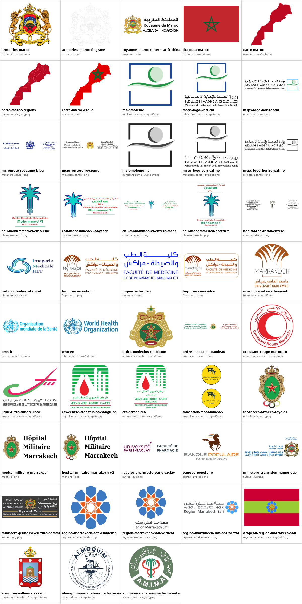

# logos-officiels-maroc

Skill Claude : bibliothèque de **48 logos officiels marocains** (PNG transparent + SVG/PDF vectoriels quand disponibles) et générateurs PDF des formulaires de la Préfecture de Marrakech.



## Installation

- **Claude (app)** : `./build.sh` → importer `dist/logos-officiels-maroc.zip` dans Paramètres → Capacités → Skills.
- **Claude Code** : copier le dossier dans `~/.claude/skills/logos-officiels-maroc/`.

## Usage rapide

```bash
python3 scripts/donner_logo.py chu --lister          # chercher
python3 scripts/donner_logo.py <id> --sortie ./out    # remettre en PNG transparent
```

## Structure

```
SKILL.md                 instructions lues par Claude
assets/catalogue.json    index des logos (id, variante, fichiers)
assets/catalogue.png     planche d'aperçu
assets/logos/<catégorie>/ fichiers des logos (seul emplacement — pas de copie ailleurs)
assets/couleur, assets/nb logos des formulaires PDF
scripts/                 donner / optimiser / agrandir / vectoriser / planche + formulaires PDF
outils/                  vérification du catalogue (hors skill)
build.sh                 planche + vérification + zip de la skill dans dist/
CONTEXT.md               contexte du projet pour les assistants IA
```

## Catalogue

### royaume

| id | description | formats |
|---|---|---|
| `armoiries-maroc` | Armoiries du Royaume (couleur) | pdf, png, svg |
| `armoiries-maroc-filigrane` | Armoiries en gris très clair — filigrane / fond de page | png |
| `royaume-maroc-entete-ar-fr-tifinagh` | Armoiries + « المملكة المغربية / Royaume du Maroc / ⵜⴰⴳⵍⴷⵉⵜ ⵏ ⵍⵎⵖⵔⵉⴱ » (horizontal) | png |
| `drapeau-maroc` | Drapeau du Maroc | pdf, png, svg |
| `carte-maroc` | Carte du Maroc (silhouette rouge, intégrité territoriale) | pdf, png, svg |
| `carte-maroc-regions` | Carte du Maroc avec les 12 régions | pdf, png, svg |
| `carte-maroc-etoile` | Carte du Maroc rouge avec l'étoile verte | png |

### ministere-sante

| id | description | formats |
|---|---|---|
| `ms-embleme` | Emblème MS seul (carré bleu, croissant, vague) — vectoriel | pdf, png, svg |
| `msps-logo-vertical` | Logo MSPS : emblème + texte arabe / tifinagh / français dessous — vectoriel | pdf, png, svg |
| `msps-logo-horizontal` | Logo MSPS horizontal : texte trilingue à gauche, emblème à droite | png |
| `ms-entete-royaume-bleu` | Bandeau d'en-tête bleu : Royaume du Maroc / Ministère de la Santé + armoiries (ancien nom) | png |
| `msps-entete-royaume` | Bandeau d'en-tête : Royaume du Maroc / Ministère de la Santé et de la Protection sociale + armoiries | png |
| `ms-embleme-nb` | Emblème du Ministère de la Santé en niveaux de gris (impression N&B, fond transparent) — même rendu que le formulaire cessation/reprise | pdf, png, svg |
| `msps-logo-vertical-nb` | Logo MSPS vertical trilingue en niveaux de gris (impression N&B, fond transparent) | pdf, png, svg |
| `msps-logo-horizontal-nb` | Logo MSPS horizontal trilingue en niveaux de gris (impression N&B, fond transparent) | png |

### chu-marrakech

| id | description | formats |
|---|---|---|
| `chu-mohammed-vi-embleme` | CHU Mohammed VI Marrakech — palmier + nom (vertical, grand) | png |
| `chu-mohammed-vi-paysage` | CHU Mohammed VI — palmier + nom ar/fr (horizontal) | png |
| `chu-mohammed-vi-entete-msps` | Bandeau Royaume + MSPS + CHU Mohammed VI (ar/fr, très large) | png |
| `chu-mohammed-vi-portrait` | CHU Mohammed VI — version portrait (petite, 180 px) | png |
| `hopital-ibn-tofail-entete` | En-tête Hôpital Ibn Tofail (CHU Mohammed VI) | png |
| `radiologie-ibn-tofail-hit` | Service Imagerie Médicale HIT (Ibn Tofail) — petit, 192 px | png |

### fmpm-uca

| id | description | formats |
|---|---|---|
| `fmpm-uca-couleur` | FMPM + UCA (palmes cuivre + texte ar/fr, horizontal) | png |
| `fmpm-texte-bleu` | FMPM texte seul ar/fr en bleu | png |
| `fmpm-uca-encadre` | FMPM + UCA avec cadre arrondi (petit, 339 px) | png |
| `uca-universite-cadi-ayyad` | Université Cadi Ayyad Marrakech — vectoriel | pdf, png, svg |

### international

| id | description | formats |
|---|---|---|
| `oms-fr` | OMS — Organisation mondiale de la Santé (français) | png, svg |
| `who-en` | WHO — World Health Organization (anglais) — vectoriel | pdf, png, svg |

### organismes-sante

| id | description | formats |
|---|---|---|
| `ordre-medecins-embleme` | Conseil National de l'Ordre des Médecins — emblème doré — vectoriel | pdf, png, svg |
| `ordre-medecins-bandeau` | Ordre National des Médecins — bandeau ar/fr + armoiries | png |
| `croissant-rouge-marocain` | Croissant-Rouge Marocain — vectoriel | pdf, png, svg |
| `ligue-lutte-tuberculose` | Ligue Marocaine de Lutte contre la Tuberculose — vectoriel | pdf, png, svg |
| `cts-centre-transfusion-sanguine` | Centre (Régional) de Transfusion Sanguine — générique, sans nom de ville — vectoriel | pdf, png, svg |
| `cts-errachidia` | Centre Régional de Transfusion Sanguine Errachidia — vectoriel | pdf, png, svg |
| `fondation-mohammed-v` | Fondation Mohammed V pour la Solidarité — vectoriel | pdf, png, svg |

### militaire

| id | description | formats |
|---|---|---|
| `far-forces-armees-royales` | Forces Armées Royales (écusson) — vectoriel | pdf, png, svg |
| `hopital-militaire-marrakech` | Hôpital Militaire Marrakech — écusson + texte | png |
| `hopital-militaire-marrakech-v2` | Hôpital Militaire Marrakech — variante (écusson avec anneaux) | png |

### autres

| id | description | formats |
|---|---|---|
| `faculte-pharmacie-paris-saclay` | Faculté de Pharmacie — Université Paris-Saclay | png, svg |
| `banque-populaire` | Banque Populaire du Maroc — vectoriel | pdf, png, svg |
| `ministere-transition-numerique` | Ministère de la Transition numérique et de la Réforme de l'Administration (en-tête) | png, svg |
| `ministere-jeunesse-culture-communication` | Ministère de la Jeunesse, de la Culture et de la Communication (blanc, pour fond sombre) | png, svg |

### region-marrakech-safi

| id | description | formats |
|---|---|---|
| `region-marrakech-safi-embleme` | Région Marrakech-Safi — emblème (rosace bleue/orange) seul | png |
| `region-marrakech-safi-vertical` | Région Marrakech-Safi — emblème + « جهة مراكش أسفي / Région Marrakech Safi » dessous | png |
| `region-marrakech-safi-horizontal` | Région Marrakech-Safi — texte ar/tifinagh/fr + emblème à droite (petit, 297 px) | png |
| `drapeau-region-marrakech-safi` | Drapeau de la Région Marrakech-Safi — vectoriel | pdf, png, svg |
| `armoiries-ville-marrakech` | Grandes armoiries de la ville de Marrakech (couronne, Koutoubia) — vectoriel | pdf, png, svg |

### associations

| id | description | formats |
|---|---|---|
| `almoquim-association-medecins-residents-marrakech` | ALMOQUIM (المقيم) — Association des Médecins Résidents de Marrakech — badge rond vectoriel : illustration et textes tracés, anneaux en cercles exacts, rosace marocaine redessinée en traits continus sur la géométrie mesurée de l'original | pdf, png, svg |
| `amima-association-medecins-internes-marrakech` | A.M.I.M.A — Association des Médecins Internes de Marrakech (جمعية الأطباء الداخليين بمراكش) — badge rond — vectorisé (tracé depuis JPG 447 agrandi ×4) ; couleurs aplaties | pdf, png, svg |

## Contribuer

Logos manquants → voir [`to-add.md`](to-add.md). Après ajout d'un fichier : mettre à jour `assets/catalogue.json` et les tableaux de `SKILL.md` / `README.md`, puis lancer `./build.sh` (régénère `catalogue.png` et signale tout écart).

## Avertissement

Les logos, armoiries et emblèmes restent la propriété de leurs organismes respectifs. Ce dépôt est un outil personnel ; leur usage doit respecter les règles de chaque institution.
